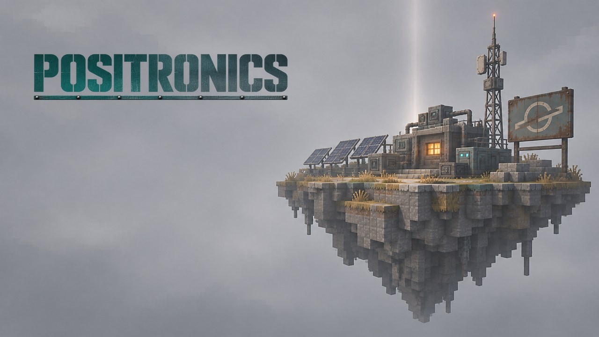

# Positronics

*The world has moved on. Rebuild the North Central Positronics network, tier by tier, and open a Door.*

A tech-only **GregTech + ProjectE skyblock** for **Minecraft 1.20.1 · Forge 47.4.0**.
You start on a small island in a dead world: no ores, no mobs, no villagers, no Nether and no End. Everything you
make comes from rock, water, sunlight and atoms, and every tier has to be earned.

**Status: beta `0.1.0-beta`** ([changelog](CHANGELOG.md)) · single player
The whole pack is playable, ULV to UHV. It's a work in progress: so far it has been played through to the end of
River Crossing (ULV), so reports from The Calla (LV) onward are especially welcome.

## What makes it different
- **Strata, not ores.** Resources come from Strata: hammered out of gravel, sifted, then made by the
  Ore Generator (USRG). Later the Reclamation Sifter Array mass-produces them.
- **Atoms are the currency.** Positronic Memory (ProjectE) learns elements only. The Atomic Reclaimer breaks
  biomass and rock into atoms, and the EMC fills Klein Stars. The stars run your generators and build the
  Positronic Cores that open each tier.
- **Power you have to plan.** Solar panels feed GregTech through energy converters, and the sun sets every
  evening. Fuel burns too, but every bucket is EMC you didn't spend on iron.
- **Survival that doesn't stop.** Thirst, body temperature, four seasons, and a hunger burn of about one bar an
  hour, AFK included. Eat a variety and you're rewarded for it.
- **A story in memos.** Ten chapters from ULV to UHV, written as North Central Positronics field memos.
  Loading-screen tips carry the memo numbers they belong to.
- **Side paths:** bees (Productive Bees), chemistry (Alchemistry), simulated mobs (Hostile Neural Networks),
  rockets and a Stargate (Ad Astra, Stargate Journey), storage from drawers to AE2, and a shop paid in NCP Scrip.

## Install
1. Install the [CurseForge app](https://www.curseforge.com/download/app).
2. Search for **Positronics** and install it. Give Minecraft at least **8 GB** of RAM.
3. Start a **new single-player world**. Read the first quests: they teach you how to drink, eat and hammer.

## Found a problem?
That's what the beta is for. [Open an issue](https://github.com/rafacost/positronics/issues/new/choose) and tell us:
- the pack version, shown on the main menu;
- what you did, and what happened instead;
- attach `logs/latest.log` and `logs/kubejs/server.log` from your game folder, or the crash report.

The in-game Field Manual has the same instructions (Section 14, Field Reports).

## For developers
| Path | What |
|---|---|
| `kubejs/*/positronics/` | All our KubeJS scripts |
| `config/`, `defaultconfigs/`, `journeymap/config/` | Only the configs we change |
| `tools/data/quests.py`, `quests_side.py` | The questbook as data; `tools/make_quests.py` writes the FTB Quests chapters |
| `tools/data/tips.py` | Loading-screen tips; `tools/make_tips.py` writes them |
| `docs/` | Design docs: pack skeleton, power, multiblocks, seed chains, story and naming |
| `tools/deploy.ps1` | Repo → game instance. Restart the game afterwards: `/reload` isn't enough in this stack. |

Mod jars are never committed; the CurseForge profile manages them.

## Credits
- Built by [rafacost](https://github.com/rafacost), who also wrote
  [USRG](https://www.curseforge.com/minecraft/mc-mods/ultimate-skyblock-generator).
- Names and premise inspired by Stephen King's *The Dark Tower* (North Central Positronics). No quoted text,
  logos or art.
- Ideas inspired by the Greg-E pack. Patterns only, no content reused.
- Tech only, no magic, by design.
